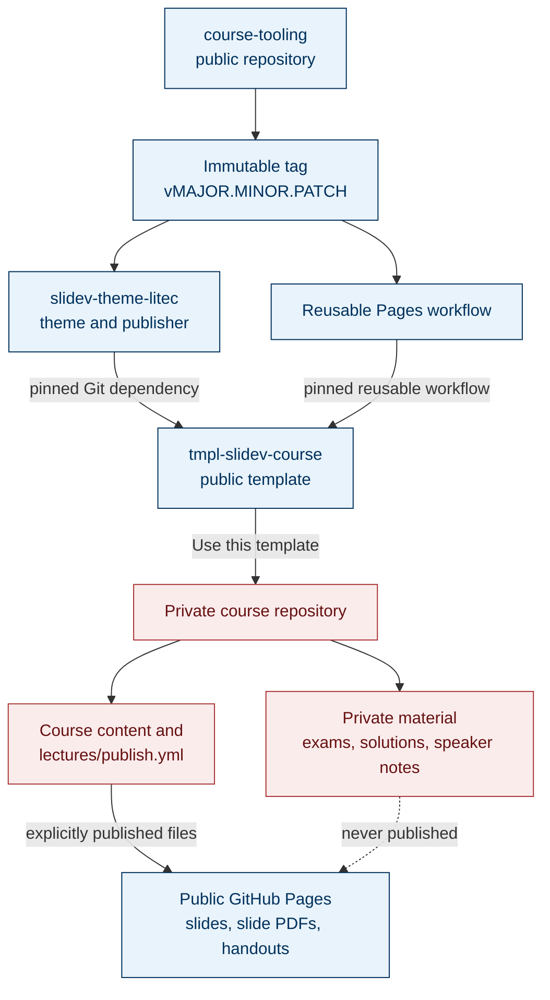

# Tooling and Course Architecture

`course-tooling` provides shared, versioned infrastructure. The public template pins an immutable tooling release, and private course repositories are created from the template.

Tooling updates do not change existing courses automatically. A new tooling tag is verified first; each template or course then updates both pins in one pull request and requires `ci / build` before merging.

> [!WARNING]
> GitHub Pages artifacts are public. Exams, solutions, and speaker notes must remain outside the publishing configuration.
